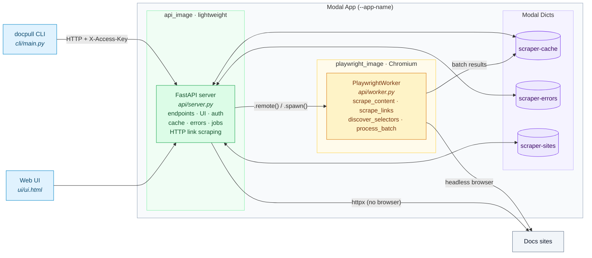
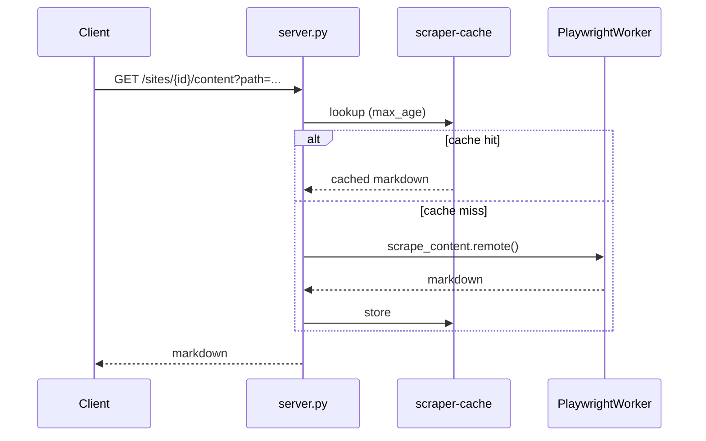
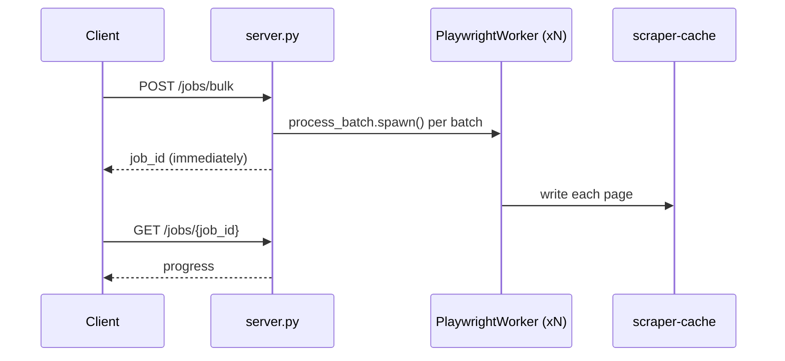
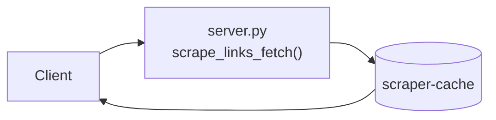

# Architecture

Docpull uses a single Modal app with separated concerns: a lightweight API server and a heavyweight Playwright worker.

## Components

## Images

### api_image (lightweight)
- Base: `debian_slim`
- Packages: `fastapi`, `pydantic`, `httpx`, `markdownify`
- Purpose: Serve API endpoints and static UI

### playwright_image (heavyweight)
- Base: `debian_slim` + Chromium
- Packages: `playwright`, `markdownify`, `httpx`
- Purpose: Browser-based scraping

## Data Flow

### Single Page Scrape

### Bulk Scrape (fire-and-forget)

### HTTP Link Discovery (no browser)

## Files

| File | Purpose |
|------|---------|
| `api/server.py` | FastAPI app, endpoints, cache/error management, UI serving |
| `api/worker.py` | PlaywrightWorkerBase class with browser methods |
| `api/bulk.py` | Job status tracking, batch calculations |
| `api/urls.py` | URL normalization and validation |
| `ui/ui.html` | Web UI (served at `/`) |
| `cli/main.py` | Typer CLI |
| `config/sites.json` | Site configurations |

## Key Design Decisions

1. **Single Modal App**: Server and worker share one app, simplifying deployment and allowing the server to call worker methods directly.

2. **Separated Images**: The API server uses a minimal image without Playwright. Browser work is dispatched to the worker class, which has its own heavyweight image with Chromium.

3. **Fire-and-forget Batches**: Bulk jobs use `.spawn()` so the server returns immediately. The worker writes results directly to the cache.

4. **Config Passed to Workers**: Workers receive full site config dicts in each call. They never read `sites.json` directly, making them stateless and testable.

5. **Inline HTTP Scraping**: Simple HTTP-based link discovery runs inline in the server (no separate Modal function), reducing latency for non-JS sites.
